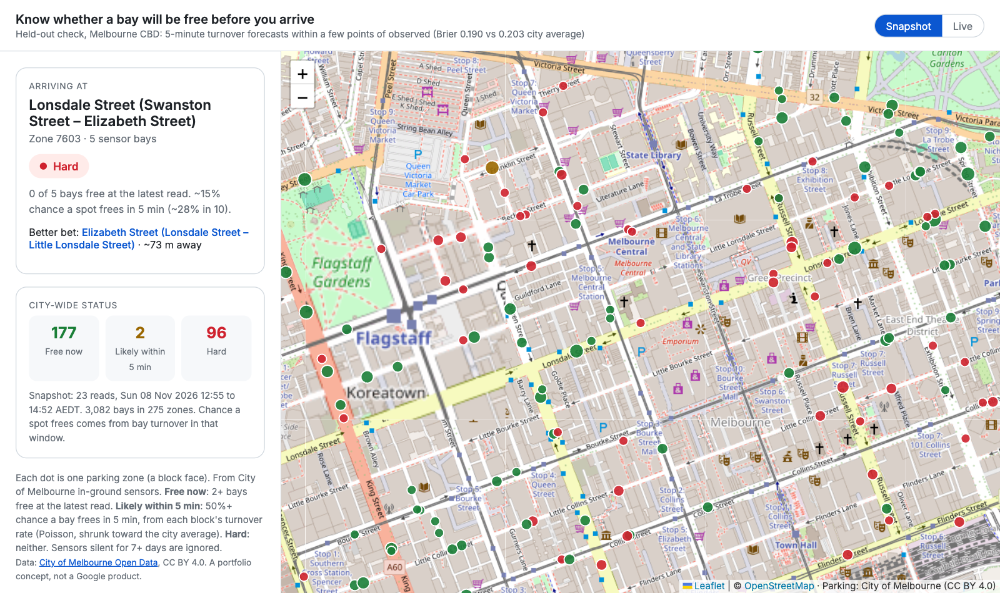

# Parking Likelihood: know if you'll find a spot before you arrive

> **PM case study + working prototype** · Maps / navigation · City of Melbourne live parking-bay sensors (open data)



**▶ [Live demo](https://akhilesh360.github.io/parking-likelihood/)** · **🎬 [60-second walkthrough](docs/demo.webm)** · [Demo script](docs/demo-script.md)

## How it works


**From the real data (Melbourne CBD, Sun 8 Nov 2026, 12:55–13:25 local, 7 reads over 30 min):**
- Of 275 scorable blocks, **141 High / 72 Medium / 62 Low**. A chip is useful because the city is not uniform: an average 43% free hides blocks at 0%.
- **42% of sensors (2,443 of 5,804) had not reported in 7+ days.** Data quality, not modelling, is the first problem to solve.
- Full blocks still move: **46 of 62 "Low" blocks had at least one bay change state** in 30 min, and the city logged ~2,460 bay changes an hour. "Low" means "expect to wait", not "never".

## 1. User and problem
Drivers heading into a dense downtown. Navigation ends at the door, but the trip ends when the car is parked. The last few minutes are spent circling, often on the busiest blocks, and the driver had no signal before arriving.

## 2. Product goal
Cut the time from arrival to parked by telling the driver, before they arrive, how likely they are to find a spot at their destination block, and pointing to a better nearby block when it's bad.

## 3. Solution and trade-offs
A small chip on the arrival card: **Parking likely / possible / hard**, plus "Better bet: <nearby block>, ~285 m" when it's hard.
- **Score:** share of bays free on the block, averaged over recent reads. High = ≥25% free and ≥2 bays; Low = <10% free or <1 bay. Simple rules beat a model until there's ground truth to train on.
- **Three levels, not a percentage.** Drivers glance; a number invites false precision.
- **Drop silent sensors** (no change in 7 days) and blocks with <4 live sensors, rather than guess.

**Not building (yet):** prediction for cities without sensor feeds; payment/reservation; off-street garages; turn-by-turn "go park here" rerouting; personal parking history. Each is bigger than the MVP and none is needed to test whether the chip changes behaviour.

## 4. North Star metric
**Median minutes from arrival to parked** for trips ending in an MVP city: time from first entering a 300 m radius of the destination to the phone's first sustained stop + walking motion (activity recognition).

## 5. Supporting metrics
- **Adoption:** % of eligible arrivals where the chip is shown (coverage × feed freshness).
- **Engagement:** tap-through rate on "Better bet" when the chip is Low.
- **Retention:** % of drivers who see the chip in week 1 and navigate to an MVP city again within 4 weeks.
- **Conversion:** % of Low-chip trips where the driver re-routes to the suggested block and parks there.

## 6. Guardrail metrics
- **Chip accuracy:** share of "likely" chips where the driver parked within 2 min of arrival; alert below 70%.
- **Herding:** occupancy of suggested blocks must not climb >10 pts vs control (we must not move the queue).
- **Distraction:** no increase in in-drive taps; chip is read-only while moving.
- **Stale data:** chip hidden if the zone's newest read is >15 min old; alert if >5% of chips served on stale data.

## 7. Prioritization
Start where the data already exists: cities with open real-time sensor feeds (Melbourne here; SF and others next). High reach per trip in dense cores, low engineering effort (no new hardware), and the result is measurable with signals Maps already has. Alternatives considered: crowd-sourced "where I parked" (needs scale first), garage availability APIs (fragmented contracts), ML from Maps' own traffic (no ground truth yet). These come after the MVP shows the chip moves the North Star.

## 8. Experiment and learning
**Test:** A/B by driver in Melbourne CBD, 4 weeks. Treatment sees the chip + better-bet link; control sees today's arrival card.
**Decision rule:** ship if median arrival-to-parked drops ≥1 min (or ≥15%) with all guardrails holding; iterate on thresholds if accuracy <70%; stop if herding fires.

**What the data in this repo shows** (real, from the live feed, one 30-minute window, so no time-of-day pattern yet):

| | |
|---|---|
| Sensors in feed / not reporting in 7+ days | 5,804 / 2,443 (42%) |
| Blocks scored (≥4 live sensors) / bays | 275 / 3,083 |
| City-wide free share | 43% (Sunday lunchtime) |
| High / Medium / Low blocks | 141 / 72 / 62 |
| Low blocks with ≥1 bay change in 30 min | 46 of 62 |


**Limits:** one 30-minute window on a Sunday; weekday peaks will look different. The historical sensor archives on the portal (2011–2020) now return no records, so hour-by-hour patterns need a few weeks of collection (`fetch.py --snapshots N`). Occupancy is not the same as search time; the North Star needs Maps' own arrival signals. Zone centroids are approximate block positions.

**Next:** collect two weeks of 10-min reads to add an hour-of-week baseline and a 15-minute forecast; validate "Low" against observed turnover; add a second city (SF).

---
**How to run it**
```bash
python3 -m venv .venv && . .venv/bin/activate && pip install -r requirements.txt
python src/fetch.py --snapshots 7 --every 5   # live reads -> data/snapshots.csv
python src/analyze.py                          # -> docs/snapshot.json + charts
python -m http.server 8765 -d docs             # open http://localhost:8765
node tools/record-demo.cjs                     # optional: hero.png + demo.webm (needs playwright)
```
Data: [City of Melbourne Open Data, On-street Parking Bay Sensors](https://data.melbourne.vic.gov.au/explore/dataset/on-street-parking-bay-sensors/) and Parking zones linked to street segments, licensed CC BY 4.0. Map tiles © OpenStreetMap contributors. Code: MIT. A portfolio concept, not affiliated with Google.

