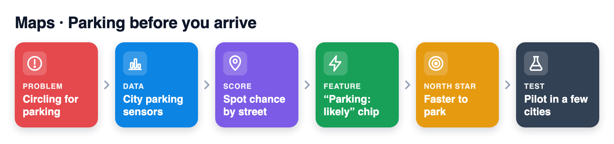
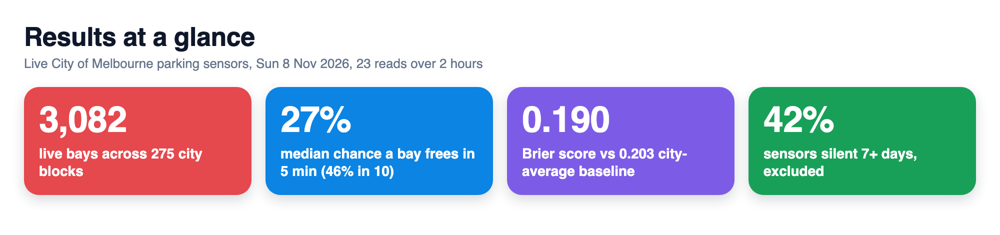
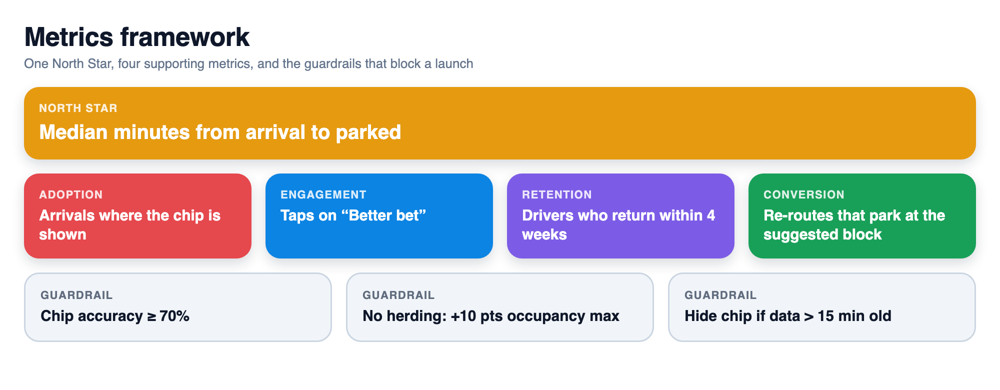
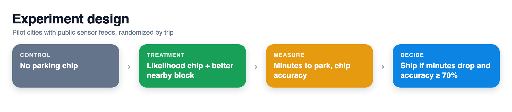
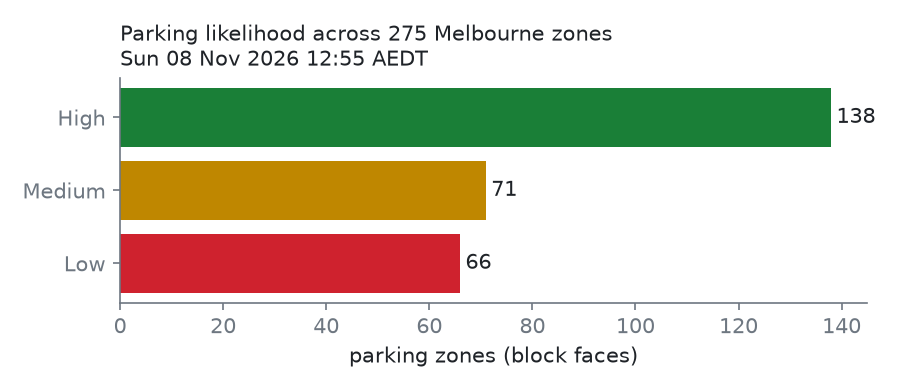
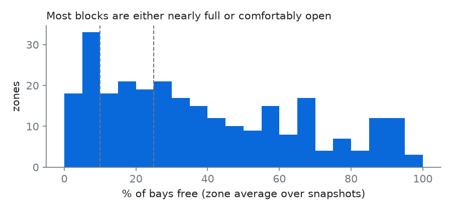
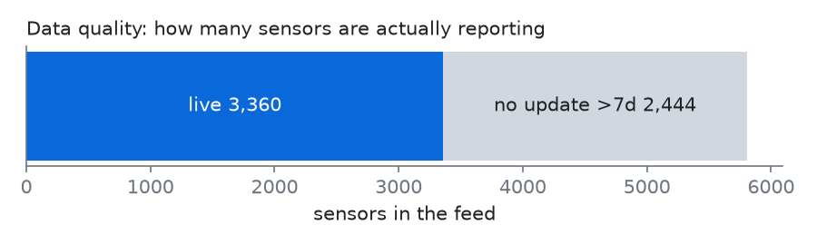
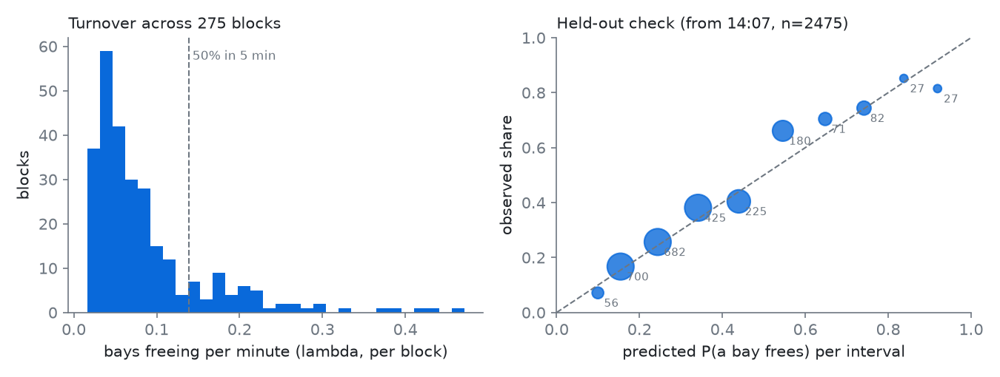

# Parking Likelihood: know if you'll find a spot before you arrive

> **PM case study + working prototype** · Maps / navigation · City of Melbourne live parking-bay sensors (open data)

**▶ 60-second demo (plays automatically)**


**Live demo: [akhilesh360.github.io/parking-likelihood](https://akhilesh360.github.io/parking-likelihood/)**

## How it works




**From the real data (Melbourne CBD, Sun 8 Nov 2026, 12:55 to 14:52 AEDT, 23 reads at ~5 min intervals):**
- Of 275 scorable blocks, **177 Free now / 2 Likely within 5 min / 96 Hard**. City-wide 41% of live bays were free, but that average hides blocks at 0%.
- **Turnover is measurable:** 2,856 bays freed up in 118 min, about 0.48 per bay per hour. The median block has a 27% chance of a bay freeing within 5 min (46% within 10).
- **The forecast holds up out of sample:** fitted on 12:55 to 14:07 and checked on 14:07 to 14:52, predicted vs observed stays within a few points across most of the range (Brier 0.190 vs 0.203 for a city-average baseline).
- **42% of sensors (2,444 of 5,804) had not reported in 7+ days.** Data quality is still the first problem to solve.

### Data
| Component | Dataset | Source / owner | License | Size used | Real or simulated |
|---|---|---|---|---|---|
| Bay occupancy | [On-street Parking Bay Sensors](https://data.melbourne.vic.gov.au/explore/dataset/on-street-parking-bay-sensors/) | City of Melbourne Open Data | CC BY 4.0 | 5,804 sensors per read; 3,082 live bays in 275 blocks; 23 reads, Sun 8 Nov 2026 12:55 to 14:52 AEDT | Real |
| Block names | [Parking zones linked to street segments](https://data.melbourne.vic.gov.au/explore/dataset/parking-zones-linked-to-street-segments/) | City of Melbourne Open Data | CC BY 4.0 | Zone to street lookup for the 275 blocks | Real |
| Turnover and chip | Derived in `src/turnover.py` from the reads above | This repo | MIT (code) | 2,856 free events; held-out check on 2,475 block intervals | Real (computed, not simulated) |

## 1. User and problem
Drivers heading into a dense downtown. Navigation ends at the door, but the trip ends when the car is parked. The last few minutes are spent circling, often on the busiest blocks, and the driver had no signal before arriving.

## 2. Product goal
Cut the time from arrival to parked by telling the driver, before they arrive, how likely they are to find a spot at their destination block, and pointing to a better nearby block when it's bad.

## 3. Solution and trade-offs
A small chip on the arrival card: **Free now / Likely within 5 min / Hard**, with "~X% chance a spot frees in 5 min" and "Better bet: <nearby block>, ~285 m" when it is not free now.
- **Free now:** 2+ bays free at the latest read (one free bay is often taken before the driver arrives).
- **Likely within 5 min:** a turnover model. Bays freeing on a block are treated as a Poisson process with rate lambda = bays × per-bay rate. The per-bay rate gets a gamma prior fitted to all blocks (empirical Bayes), so a quiet or small block is pulled toward the city average instead of reading as 0% or 100%. P(a bay frees within T min) = 1 - exp(-lambda × T); the label applies at 50%+ for T = 5.
- **Hard:** neither. The percentage still tells the driver whether waiting is reasonable.
- **Three levels, not a percentage.** Drivers glance; a number invites false precision.
- **Drop silent sensors** (no change in 7 days) and blocks with <4 live sensors, rather than guess.

**Not building (yet):** prediction for cities without sensor feeds; payment/reservation; off-street garages; turn-by-turn "go park here" rerouting; personal parking history. Each is bigger than the MVP and none is needed to test whether the chip changes behaviour.

## 4. North Star metric



**Median minutes from arrival to parked** for trips ending in an MVP city: time from first entering a 300 m radius of the destination to the phone's first sustained stop + walking motion (activity recognition).

## 5. Supporting metrics
- **Adoption:** % of eligible arrivals where the chip is shown (coverage × feed freshness).
- **Engagement:** tap-through rate on "Better bet" when the chip is Low.
- **Retention:** % of drivers who see the chip in week 1 and navigate to an MVP city again within 4 weeks.
- **Conversion:** % of Low-chip trips where the driver re-routes to the suggested block and parks there.

## 6. Guardrail metrics
- **Chip accuracy:** share of "likely" chips where the driver parked within 2 min of arrival; alert below 70%.
- **Herding:** occupancy of suggested blocks must not climb >10 pts vs control (we must not move the queue).
- **Distraction:** no increase in in-drive taps; chip is read-only while moving.
- **Stale data:** chip hidden if the zone's newest read is >15 min old; alert if >5% of chips served on stale data.

## 7. Prioritization
Start where the data already exists: cities with open real-time sensor feeds (Melbourne here; SF and others next). High reach per trip in dense cores, low engineering effort (no new hardware), and the result is measurable with signals Maps already has. Turnover is modelled before occupancy forecasting because it answers the driver question directly ("will something open up?") and validates in minutes, not weeks. Alternatives considered: crowd-sourced "where I parked" (needs scale first), garage availability APIs (fragmented contracts), ML from Maps' own traffic (no ground truth yet). These come after the MVP shows the chip moves the North Star.

## 8. Experiment and learning



**Test:** A/B by driver in Melbourne CBD, 4 weeks. Treatment sees the chip + better-bet link; control sees today's arrival card.
**Decision rule:** ship if median arrival-to-parked drops ≥1 min (or ≥15%) with all guardrails holding; iterate on thresholds if accuracy <70%; stop if herding fires.

**What the data in this repo shows** (real, from the live feed, one 118-minute window on a Sunday afternoon, so no time-of-day pattern yet):

| | |
|---|---|
| Sensors in feed / not reporting in 7+ days | 5,804 / 2,444 (42%) |
| Blocks scored (≥4 live sensors) / bays | 275 / 3,082 |
| City-wide free share | 41% (Sunday afternoon) |
| Free now / Likely within 5 min / Hard | 177 / 2 / 96 |
| Bays freed in 118 min / per bay per hour | 2,856 / 0.48 |
| Median block P(bay frees in 5 / 10 min) | 27% / 46% |
| Held-out mean predicted vs observed (2,475 intervals) | 31.4% vs 33.3% |
| Brier score: model vs city-average baseline | 0.190 vs 0.203 |






**Limits:** one 118-minute window on a Sunday afternoon (reads paused 13:25 to 13:37); weekday peaks will look different, and rates are assumed constant within the window. The held-out check covers only the last 45 minutes, and its top bins hold under 30 intervals each, so they are noisy. A "free event" is a bay reporting Unoccupied with a new timestamp between reads, so a bay that frees and refills within 5 min is missed and true turnover is higher. "Likely within 5 min" rarely fires (2 blocks) because blocks with high turnover usually already have free bays. The historical sensor archives on the portal (2011–2020) now return no records, so hour-by-hour patterns need a few weeks of collection (`fetch.py --snapshots N`). Occupancy is not the same as search time; the North Star needs Maps' own arrival signals. Zone centroids are approximate block positions.

**Next:** collect two weeks of 10-min reads to add an hour-of-week baseline and a 15-minute forecast; refit turnover rates by hour of week; add a second city (SF).

---
**How to run it**
```bash
python3 -m venv .venv && . .venv/bin/activate && pip install -r requirements.txt
python src/fetch.py --snapshots 7 --every 5   # live reads -> data/snapshots.csv
python src/analyze.py                          # -> docs/snapshot.json + charts
python src/turnover.py                         # -> turnover fields + chip in snapshot.json, docs/turnover.png
python -m http.server 8765 -d docs             # open http://localhost:8765
node tools/record-demo.cjs                     # optional: hero.png + demo.webm (needs playwright)
```
Data: [City of Melbourne Open Data, On-street Parking Bay Sensors](https://data.melbourne.vic.gov.au/explore/dataset/on-street-parking-bay-sensors/) and Parking zones linked to street segments, licensed CC BY 4.0. Map tiles © OpenStreetMap contributors. Code: MIT. A portfolio concept, not affiliated with Google.

